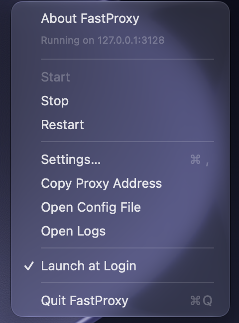
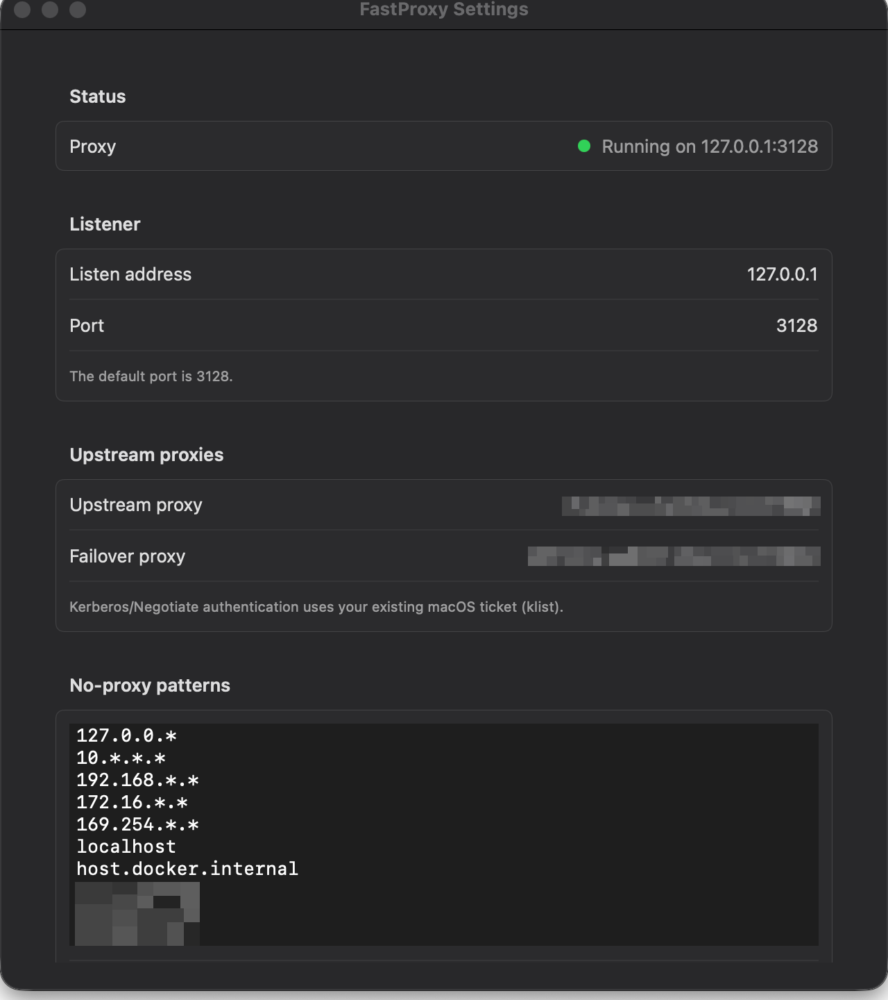
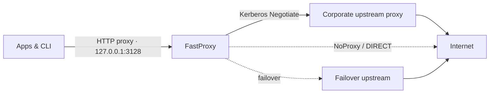
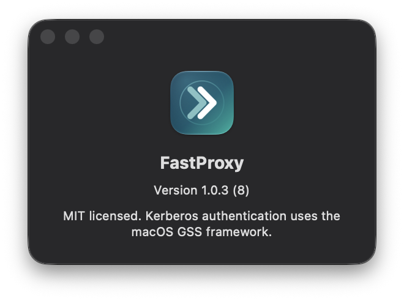

<p align="center">
  
</p>

<p align="center">
  <a href="https://github.com/JohannesBauer97/fastproxy/releases/latest"></a>
  <a href="https://github.com/JohannesBauer97/fastproxy/actions/workflows/release.yml"></a>
  
  
  
  <a href="LICENSE"></a>
</p>

<p align="center">
  <strong>The native macOS alternative to the Px proxy.</strong><br>
  HTTP/HTTPS forwarding, Kerberos/SPNEGO, upstream failover, and a proper menu bar app.
</p>

<p align="center">
  <a href="#quick-start">Quick start</a> ·
  <a href="#why-fastproxy">Why FastProxy</a> ·
  <a href="#configuration">Configuration</a> ·
  <a href="#cli">CLI</a> ·
  <a href="#development">Development</a>
</p>

## Quick start

```bash
brew install --cask JohannesBauer97/tap/fastproxy
```

Open **FastProxy** from `/Applications`. The proxy starts on `127.0.0.1:3128`.
Set your upstream proxy in **Settings…**, then point your app or shell at the local
proxy.

> [!TIP]
> On a domain-joined Mac, FastProxy uses the Kerberos ticket already in your login
> session. Check it with `klist`.

<p align="center">
  
  
</p>
<p align="center"><sub>The menu bar and settings. Upstream fields in the screenshot are redacted.</sub></p>

## Why FastProxy

- **The native Px alternative.** FastProxy brings the Px proxy workflow to macOS
  as a signed, notarized menu bar app.
- **Native by design.** Swift, SwiftUI/AppKit, Network.framework, and the system
  GSS.framework. No separate runtime and no bundled third-party proxy engine.
- **Kerberos-first.** Uses the ticket in your macOS login session. No passwords in
  configuration and no separate credential prompt.
- **Built for real upstreams.** Primary and failover proxies, DIRECT fallback, and
  NoProxy rules for exact hosts, suffixes, wildcards, and CIDR ranges.
- **A proper menu bar app.** Start, stop, restart, edit settings, open config/logs,
  and launch at login.
- **Release-grade.** Developer ID signed, hardened, notarized, and distributed
  through Homebrew.

## How it works



FastProxy listens on loopback, forwards plain HTTP, and tunnels HTTPS with
`CONNECT`. When an upstream proxy is configured, it authenticates with
Kerberos/SPNEGO. Hosts matching a NoProxy rule bypass the upstream. If the primary
upstream fails, the failover proxy is tried next.

## Features

| Capability | What it does |
|---|---|
| **HTTP & HTTPS** | HTTP/1.1 forwarding and HTTPS `CONNECT` tunneling. |
| **Kerberos/SPNEGO** | Pre-emptive `Proxy-Authorization: Negotiate …` plus 407 challenge/response through GSS.framework. |
| **Upstream failover** | Primary and failover upstream proxies, with DIRECT fallback. |
| **NoProxy rules** | Exact hosts, `*.example.com` suffixes, `10.*.*.*` wildcards, and IPv4/IPv6 CIDR ranges. |
| **Menu bar** | Live status, start/stop/restart, settings, config/log shortcuts, launch at login. |
| **Operations** | `GET /health` readiness endpoint and a rolling log file. |
| **Headless CLI** | Run the same core from scripts, CI, or a terminal. |
| **Config compatibility** | Imports existing FastProxy `appsettings.json` files unchanged. |

## Install

### Homebrew (recommended)

```bash
brew install --cask JohannesBauer97/tap/fastproxy
```

This installs `FastProxy.app` into `/Applications` and links the bundled
`fastproxy-cli` into Homebrew's `bin` directory.

```bash
brew upgrade --cask fastproxy
brew uninstall --cask fastproxy
brew uninstall --zap --cask fastproxy   # also remove configuration and logs
```

### Prebuilt release

Download the latest `FastProxy-*-macos-arm64.zip` from
[Releases](https://github.com/JohannesBauer97/fastproxy/releases), unzip it, move
`FastProxy.app` to `~/Applications`, and open it.

Release builds are Developer ID signed and notarized. If macOS still blocks the
app, open **System Settings → Privacy & Security** and choose **Open Anyway**.

### From source

```bash
make app
./Scripts/install.sh
```

Local builds are ad-hoc signed.

### Requirements

- macOS 13 or later
- Apple Silicon for the prebuilt release; source builds target the host architecture
- Xcode 15+ or Xcode Command Line Tools for source builds
- A valid Kerberos ticket (`klist`) for an authenticated upstream

## Configuration

FastProxy reads and writes:

```text
~/Library/Application Support/FastProxy/appsettings.json
```

On first start, if that file does not exist and `~/.fastproxy/appsettings.json`
exists, the legacy settings are imported unchanged. The configuration is stored
with mode `0600` because it can contain private upstream hostnames.

The menu bar **Settings…** window edits the same file; **Save & Restart** validates
the values and restarts the in-process proxy.

```json
{
  "Proxy": {
    "Listen": "127.0.0.1",
    "Port": 3128,
    "UpstreamProxy": "proxy.example.com:8080",
    "FailoverProxy": "fallback.example.com:8080",
    "NoProxy": [
      "localhost",
      "127.0.0.1",
      "10.*.*.*",
      "192.168.*.*",
      "*.example.com"
    ],
    "BufferSize": 8192,
    "ConnectionTimeout": 20
  },
  "Logging": {
    "LogLevel": {
      "Default": "Information"
    }
  }
}
```

| Setting | Default | Description |
|---|---|---|
| `Listen` | `127.0.0.1` | Listen address. Keep it on loopback unless you intend to expose the proxy. |
| `Port` | `3128` | Listen port. |
| `UpstreamProxy` | empty | Primary upstream `host:port`. Empty means DIRECT. |
| `FailoverProxy` | unset | Optional fallback upstream `host:port`. |
| `NoProxy` | `localhost`, loopback | Direct-connect patterns; exact, suffix, wildcard, and CIDR forms. |
| `BufferSize` | `8192` | Relay buffer size in bytes. |
| `ConnectionTimeout` | `20` | TCP connect and handshake timeout in seconds. |
| `Logging.LogLevel.Default` | `Information` | `Trace`, `Debug`, `Information`, `Warning`, `Error`, `Critical`. |

## Authentication

FastProxy uses Kerberos/SPNEGO via `GSS.framework`. On a domain-joined Mac, the
normal `Negotiate` path uses the ticket already in your login session; no password
is stored in the configuration.

```bash
klist
```

The upstream proxy host needs an `HTTP/<host>@<REALM>` service ticket. If the
upstream only accepts NTLM and no Kerberos service is available, FastProxy reports
a 502 and logs the authentication failure. Use a Negotiate-capable upstream in
that environment. Authentication tokens are never written to the log.

## Menu bar

- **Green dot:** proxy is running
- **Orange dot:** starting
- **Red dot:** stopped or failed

The menu provides About, Start, Stop, Restart, Settings, Copy Proxy Address, Open
Config File, Open Logs, Launch at Login, and Quit. The proxy starts automatically
when the app launches, including at login.

<p align="center">
  
</p>
<p align="center"><sub>About FastProxy — the app bundle is Developer ID signed and notarized.</sub></p>

## CLI

The app bundle and the Swift package ship a CLI that uses the same core:

```bash
fastproxy-cli --config ~/Library/Application\ Support/FastProxy/appsettings.json
fastproxy-cli --port 3128 --upstream proxy.example.com:8080 --no-proxy 'localhost,10.*.*.*'
```

Useful flags: `--config`, `--port`, `--listen`, `--upstream`, `--failover`,
`--no-proxy`, `--log-level`, `--log-dir`, `--install-login-item`,
`--uninstall-login-item`.

## Logs

```text
~/Library/Application Support/FastProxy/logs/fastproxy.log
```

Logs rotate at 10 MiB and keep seven archives. The menu bar **Open Logs** item
reveals the folder.

## Security

- The proxy binds to `127.0.0.1` by default and has no client authentication.
  Do not bind to a non-loopback address on an untrusted network.
- Runtime logs and configuration can contain private hostnames; both stay outside
  the repository, and the configuration is mode `0600`.
- Authentication tokens are never written to the log.
- Release builds use the hardened runtime, a Developer ID signature, and Apple
  notarization.
- This repository contains only example hostnames and no employer-specific
  internal information.

## FAQ

### Which port does FastProxy use?

`3128` by default, matching the standard proxy convention. Change `Proxy.Port` in
Settings or `appsettings.json` if another service already uses it.

### The app cannot bind to 3128.

Another process is listening on that port. Choose a different port in **Settings…**.

### Kerberos authentication fails or returns 502.

Run `klist` and make sure the ticket is valid. The upstream proxy host needs an
`HTTP/<host>@<REALM>` service ticket. NTLM-only upstreams are not supported.

### macOS says the app cannot be opened.

Release builds are notarized. If needed, open **System Settings → Privacy &
Security** and choose **Open Anyway**. Homebrew installation is the recommended
path.

### Where are configuration and logs?

```text
~/Library/Application Support/FastProxy/appsettings.json
~/Library/Application Support/FastProxy/logs/
```

## Development

```bash
swift build
swift test
./Scripts/build-app.sh
```

The test suite covers configuration, header parsing, NoProxy matching, direct
HTTP, CONNECT tunnels, upstream failover, 407 challenge/response, chunked bodies,
large downloads, concurrency, and LaunchAgent generation. Kerberos tests are
opt-in:

```bash
FASTPROXY_GSS_TEST_HOST=proxy.example.com swift test --filter GSSAuthenticatorTests
```

Internal benchmark notes are in [docs/benchmark.md](docs/benchmark.md).

<details>
<summary>Repository layout</summary>

```text
Sources/FastProxyCore/     proxy engine, config, GSS, logging
Sources/FastProxyApp/      SwiftUI menu bar app and settings
Sources/FastProxyCLI/      headless runner and login-item helper
Sources/CGSS/              small C bridge to GSS.framework
Tests/FastProxyCoreTests/  unit and integration tests
Scripts/                   build, install, uninstall
Resources/                 app metadata, icon, and icon sources
docs/                      benchmark notes and README assets
```
</details>

<details>
<summary>Releasing (maintainers)</summary>

Pushing a stable tag triggers the release workflow, which runs the tests, builds
and notarizes the Apple Silicon app, publishes the GitHub release, and updates the
Homebrew tap:

```bash
git tag v1.2.3
git push origin v1.2.3
```

Pre-release tags such as `v1.2.3-rc.1` publish a GitHub pre-release but do not
update the Homebrew tap.

The workflow expects these repository secrets:

- `APPLE_CERTIFICATE_P12_BASE64`
- `APPLE_CERTIFICATE_PASSWORD`
- `APPLE_API_KEY_ID`
- `APPLE_API_ISSUER_ID`
- `APPLE_API_KEY_P8_BASE64`
- `HOMEBREW_TAP_TOKEN`

The certificate must be a **Developer ID Application** certificate exported with
its private key. An **Apple Development** certificate cannot be used for
notarization.
</details>

## Contributing

Issues and pull requests are welcome. Run `swift test` before opening a PR.

## License

MIT. See [LICENSE](LICENSE).

<p align="center"><sub>Built with Swift, SwiftUI/AppKit, Network.framework, and GSS.framework.</sub></p>
